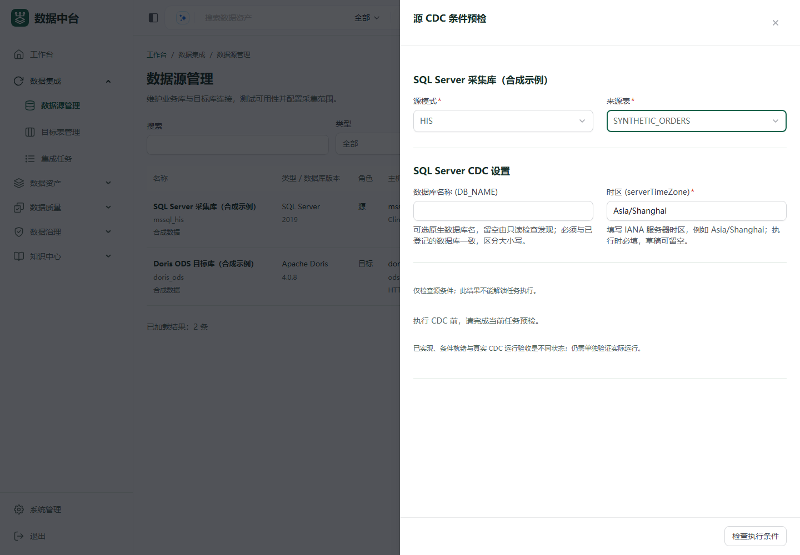
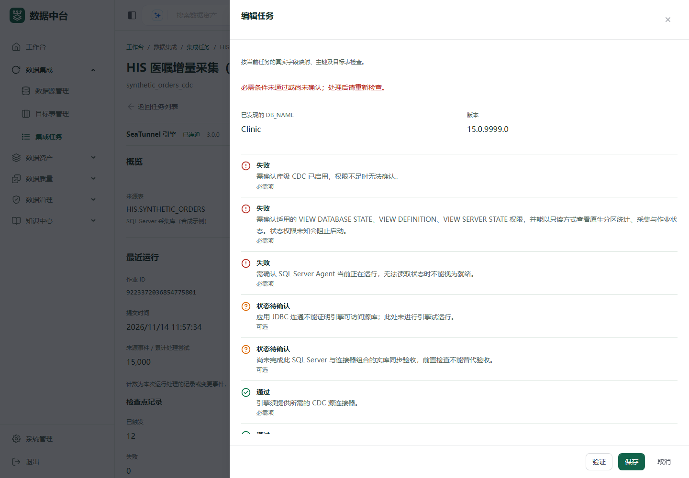

# SQL Server CDC 验证与测试部署记录

日期：2026-11-14。用户已明确要求完成适配并部署测试环境，SQL Server 实库稍后绑定。本轮不等待额外发布确认；没有执行源库授权、CDC 开关、重启、源表 DML 或新目的地址的网络放行。

## 代码与离线验证

| 项目 | 本轮结果 |
| --- | --- |
| 引擎 | `72274243`，固定 SeaTunnel 3.0.0 基础镜像，增加同版本 Oracle/SQL Server CDC 连接器；既有 PostgreSQL、JDBC、Doris、Oracle NLS 与驱动保持 |
| 服务端 | `ddce3c05`、`6f7bb275`、`eaf5cbae`；439/439 单元测试、40 类、0 失败/跳过/中止。4 个已有实库选择性测试类在发现前排除，不计为通过 |
| 完整服务包 | 离线 Maven package 成功；服务 JAR SHA256 `d12af4ef72ab7d2b7cd66223dc417ba942ab77e41b0c1393a76633a5ae8e7e9e`，确认包含全部新 SQL Server 类 |
| 页面 | `76360c26`、`80218538`；13 套、299/299 测试通过；导入整理、ESLint 修复、Prettier 及只读复查通过 |
| 多语言 | 20 个语言各新增24条，共480条真实翻译；每种语言此前5051个值保持。88个预检码和10个操作拒绝码均映射到译文 |
| TypeScript | 全局仍有550个已有诊断，本轮拥有的集成页面/API范围为0；不声称全局类型检查通过 |
| 原生工厂和数据事件 | 无网络、只读一次性容器核对真实工厂、隔离加载、TLS、整数边界、tinyint 255、小数、中文、日期、四种 RowKind 与 Doris 删除标记；容器均移除 |
| 真实配置生成联动 | 实际服务端生成的合成 SQL Server 配置被原生工厂接受；原生 SQL 投影保留别名、18位小数与毫秒，INSERT/UPDATE_AFTER/UPDATE_BEFORE/DELETE 的 Doris 序列化通过 |
| PC 页面 | 实际当前 React 导航与页面组件，1440×1000、1920×1080 共24张截屏；右侧抽屉几何、页脚、焦点和页面溢出检查通过，浏览器异常为空。全部接口由合成数据拦截，没有启动页面服务或访问医院接口 |

独立审查修复并复核了三项问题：系统目录原生名称大小写、分片统计需要的定义可见性，以及首次快照 `SELECT *` 所需的全部物理列读取权限。恢复指纹绑定稳定的数据库/表/采集实例身份，不包含移动 LSN 和作业时间；旧 Oracle/Postgres 指纹金样保持一致。

页面质量审查还修复了原生运行/恢复前置拒绝后旧的绿色预检状态残留：六个明确拒绝码共享同一列表，12个回归用例确认清除旧结果后必须重新检查。`80218538`没有改变样式或翻译，PC产物和24张截屏已刷新。

以下是当前组件在1440像素桌面宽度下的合成数据截屏，不代表实库已接入或CDC已通过验收。

原生负微秒转换缺陷已复现，首版阻断捕获时间字段精度超过3的组合。未捕获且未映射的物理字段不被无依据地新增类型限制；其快照读取权限仍必须满足。范围和操作流程见 [接入说明](sqlserver-cdc-support.md)。

## 测试升级执行

**已部署并验证。** 2026-11-14 12:43（北京时间），两个工作负载恢复单副本且就绪，3项应用健康检查全部通过。新引擎实际加载 Oracle-CDC、SqlServer-CDC 和 Postgres-CDC；引擎运行和待提交作业均为0。旧的 Oracle 单独候选没有作为中间版本发布。

| 工作负载 | 实际部署固定摘要 |
| --- | --- |
| 应用 | `harbor.qcrmyy.local/coop/hospital-openmetadata@sha256:a7008338dc47e49f0cb11690a334d61660a3d248ce124078ceefb07395153ed3` |
| 引擎 | `harbor.qcrmyy.local/coop/hospital-seatunnel@sha256:0f878ad69e1aea9af967a4295d27d631a0baf77cdf5ec7140f292a44056efe63` |

应用源码标识为 `96b9d8fe9e09522d368714c22405ee4b2c443e0d`；服务 JAR 为上表 d12af4…，UI JAR SHA256 为 `a070200ee69d72e59a269e7d2f7d4f54c1c25dce5860a49367386998e652a85a`。生产 UI 共4424个文件，2536个压缩文件逐项匹配；最终 Impeccable 批量检查无发现。实际入口 [数据中台](http://172.16.120.211:30925) 提供本次 `/assets/index-zAfsczDl.js`，响应字节摘要与发布包一致；两个集成接口对未认证请求返回401。没有使用员工登录或模拟票据来冒充 SSO 验收。

升级前应用冻结、实际 Pod 退出及引擎空闲均已核对，随后在既有 PostgreSQL PVC 的 `/var/lib/postgresql/data/hospital-integration-upgrades/81bc28f0df46` 保存1条任务扩展，SHA256 `1f9f413e51051047769da692646f2a5e27a44505a35b683d5a95afc2a03309dc`，目录0700、文件0600，未导出内容到工作区。升级后仍为1条FAILED任务、0启用调度、0待初始化。

Harbor 回拉后同时核对原生归档、配置及文件层。Docker 当前返回 OCI 清单/索引标识，配置摘要属于另一层；引擎索引 `harbor.qcrmyy.local/coop/hospital-seatunnel@sha256:83cec60646a1e6159f49896c1b2849c227555f13c9d7707cd17e8bf84c4f8398` 保留为溯源，部署明确选择已核验的 linux/amd64 子清单。记录中区分这些标识，没有以可变标签或本地标识冒充部署摘要。机器可读信息见 [本轮发布清单](sqlserver-cdc-test-release.json)。

两个原镜像仍记录在发布清单中。旧服务不能直接读取新任务字段；回退必须先冻结、归档当前任务并按受限备份恢复精确扩展，不能仅回退镜像。原有备份/恢复脚本字节未变，本轮未执行恢复。

仅升级 `datahub-open-test` 内既有 `Deployment/hospital-openmetadata` 和 `StatefulSet/hospital-seatunnel`。身份、Secret、PVC、检查点、Doris 与网络策略保持。应用冻结和恢复单副本属于本次受控升级窗口。

## 真实数据库验收边界

本轮尚未登记 SQL Server 实库，未验证 SQL Server 的首次快照、并发增删改、进程重启、检查点恢复或日志清理过期。离线事件、配置生成和页面模拟均不代替这些验收。用户绑定来源及专用记录范围后，按接入说明使用独立 Doris 目标进行对账。

原有 HIS Oracle 的归档、补充日志、LOB 与真实 CDC 验收条件没有被此升级自动修复或授权。现有已批准的单地址 TCP1521 规则保持，不重复申请，也不扩展至未知 SQL Server 地址。
